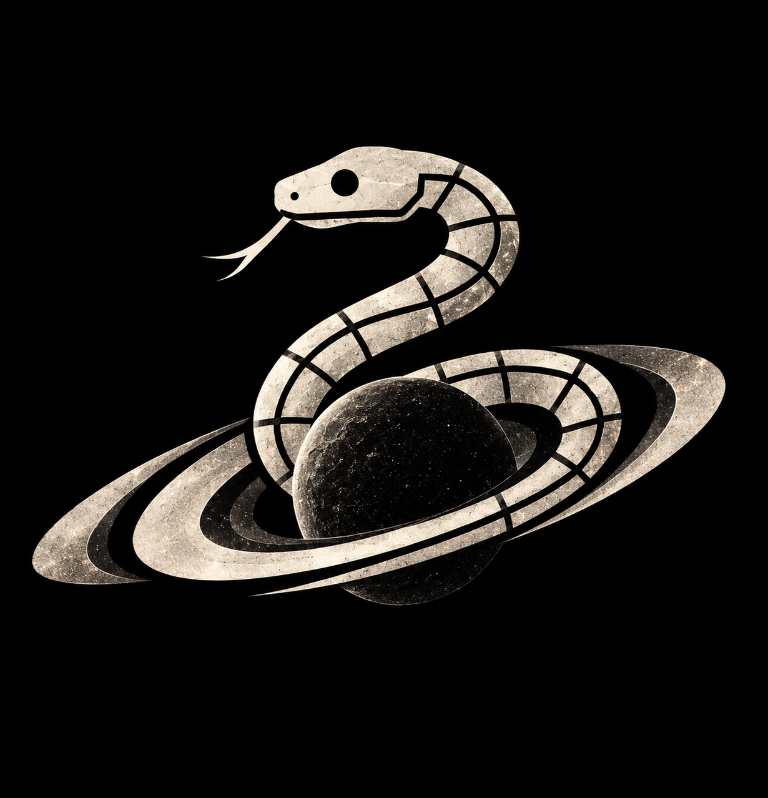
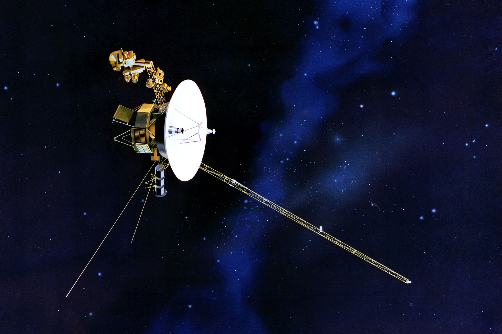
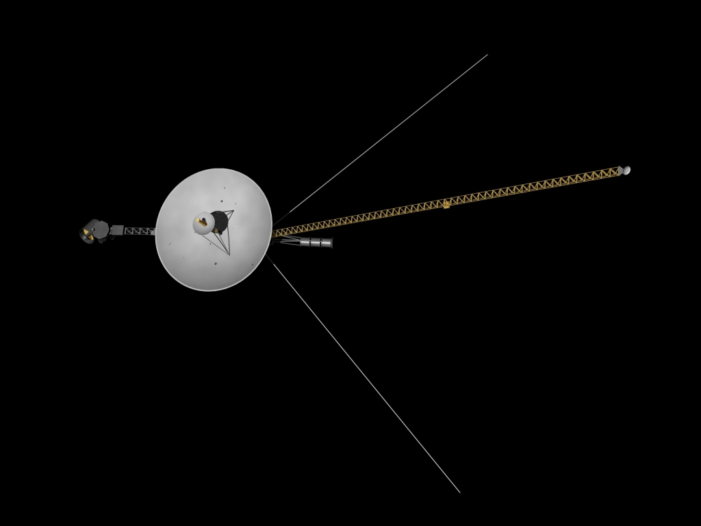
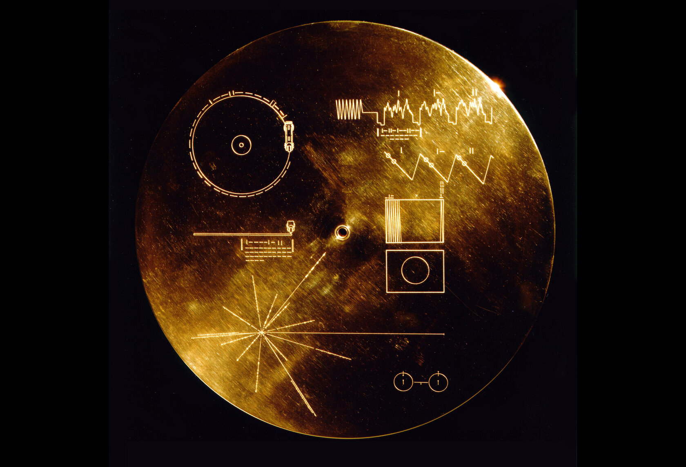

# One Light-Day

* **ID:** NS-P006
* **Date:** 18.11.26

## The Distance of One Light-Day

On November 18, 2026, **Voyager 1** reached a remarkable milestone: the spacecraft became approximately **one light-day away from Earth**.

Launched by NASA in September 1977, Voyager 1 was designed to explore the outer planets of our Solar System. After completing its primary mission, it continued its journey beyond the heliosphere and entered interstellar space in 2012.

A **light-day** is a unit of distance, defined as the distance light travels through a vacuum in 24 hours.

Since light travels at approximately **299,792 kilometers per second**, one light-day is equivalent to about **25.9 billion kilometers**.

At this distance, a radio signal traveling from Earth to Voyager 1 takes approximately 24 hours to reach the spacecraft. The same amount of time is required for a signal traveling back to Earth.

This means that even if engineers send a command to Voyager 1, they cannot expect an immediate response. Communication with the spacecraft has become a process that unfolds over days rather than seconds.

Voyager 1 continues its journey through interstellar space, carrying with it the **Golden Record** – a collection of sounds, images and messages representing life on Earth.

It is a remarkable reminder of how far humanity's exploration has reached.

© NESTIMS
